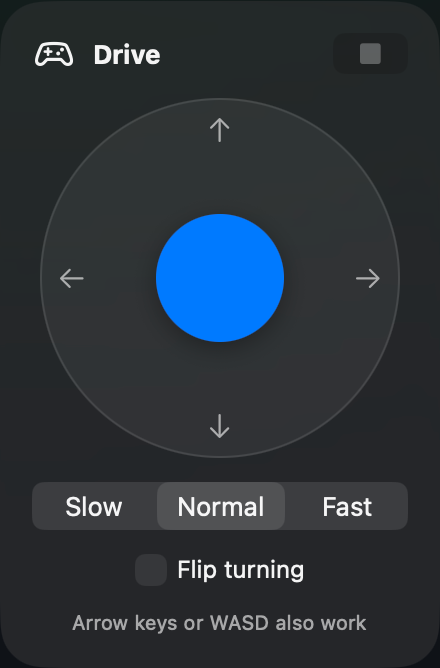

# Vacuum

A native macOS app for the **Xiaomi Robot Vacuum X20+** (`xiaomi.vacuum.c102gl`). It talks to the robot directly over your home network and uses Xiaomi's cloud only to fetch the map.


*The floor plan is pixelated in this screenshot for privacy.*

## Features

- **Live map** with the robot's position and cleaning path, zoom and pan.
- **Clean by room:** click the rooms you want, then press Start. Rooms can be renamed or hidden.
- **Robot controls:** start, stop, go home, empty the bin and locate the robot, plus suction, mop and cleaning mode.
- **Zones and walls:** draw no-go zones, no-mop zones and virtual walls, with restore of the previous layout.
- **Room editing:** merge or divide rooms.
- **Furniture:** place furniture on the map for reference.
- **Schedules:** create, edit and delete scheduled cleans.
- **Insights:** cleaning history, per-room stats and problems the robot reported.
- **Parts and settings:** brush, filter and mop pad life, do-not-disturb hours.
- **Drive:** control the robot by hand (see below).

### Drive the robot by hand

Click **Drive** (gamepad icon) in the toolbar. A joystick appears at the bottom left of the map, so you can watch the robot while you drive.



- Drag the stick, or use the **arrow keys** or **WASD**. Let go to stop.
- Pick **Slow**, **Normal** or **Fast**.
- If the robot turns the opposite way from the stick, tick **Flip turning**.
- **Stop** (or switching Drive off) halts the robot and leaves manual mode.

> If you don't see **Drive**, widen the window: macOS hides toolbar items behind a **»** menu when there isn't room.

## Install

Requires **macOS 26 or later** (Apple Silicon or Intel).

1. Download **Vacuum.dmg** from the [latest release](../../releases/latest).
2. Open it and drag **Vacuum** into **Applications**.
3. Open Vacuum. The app isn't signed with an Apple Developer ID, so macOS blocks the first launch. Either:
   - go to **System Settings → Privacy & Security**, scroll down and click **Open Anyway** next to Vacuum; or
   - run this in Terminal:
     ```bash
     xattr -dr com.apple.quarantine /Applications/Vacuum.app
     ```

## Set up your robot

On first launch, sign in with your Xiaomi account:

1. Choose your Xiaomi region and scan the QR code with the Mi Home app (or sign in on Xiaomi's website). Your password goes only to Xiaomi, never through this app.
2. Pick your robot from the list. The app fills in its IP address, token and ID.
3. If sign-in doesn't work, use the manual entry and type the robot's IP address and token yourself.

Your robot's token and Xiaomi login stay on your Mac, in the Keychain. The Mac and the robot must be on the same Wi-Fi network.

## Build from source

You need Xcode 26 and [XcodeGen](https://github.com/yonaskolb/XcodeGen).

```bash
brew install xcodegen
xcodegen generate
open Vacuum.xcodeproj
```

The map tests use a real map file that isn't included in the repo, because a map shows the layout of a home. Those tests fail until you add your own `VacuumTests/Fixtures/map_raw.txt`.

## Disclaimer

An unofficial project, not affiliated with Xiaomi or Dreame. Use it at your own risk, and keep an eye on the robot while driving it by hand.
