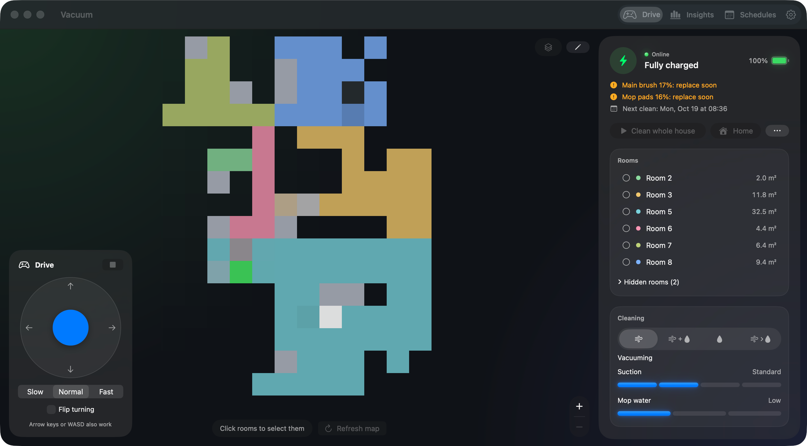
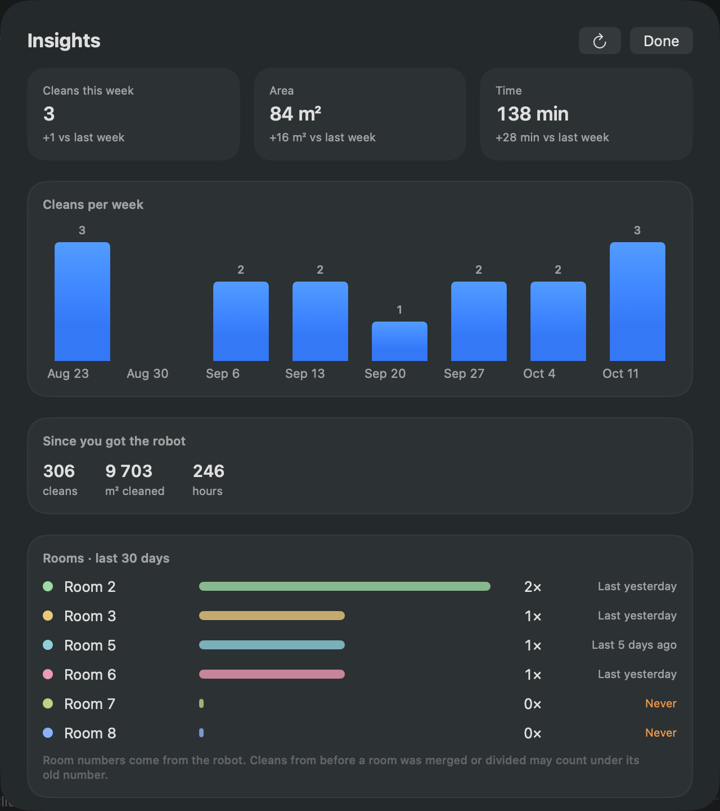
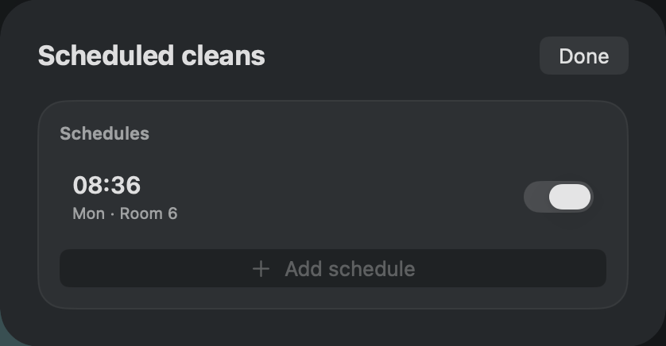
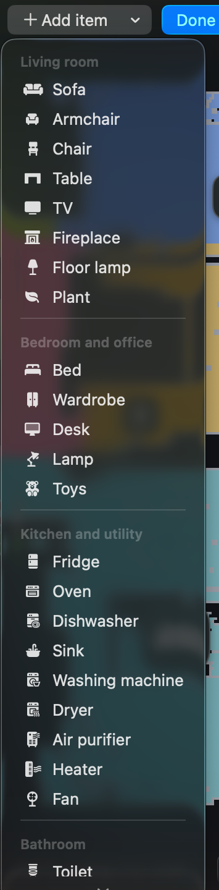
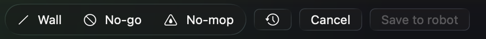

# Vacuum

Control your **Xiaomi Robot Vacuum X20+** (`xiaomi.vacuum.c102gl`) from a Mac app, and from **AI agents** such as Claude, through MCP. Everything talks to the robot directly over your home network; Xiaomi's cloud is used only to sign in and fetch the map.

There are two parts, and you can use either one:

- **The Vacuum app** (macOS): map, rooms, schedules, insights, furniture and more.
- **`vacuumd`**, a small background program for **Windows, macOS and Linux**. It lets AI agents drive the robot, and it is what the app uses to reach the robot. You can install it on its own, with no app.



*The floor plan is pixelated in this screenshot for privacy.*

## Features

### Map and cleaning
A live map with the robot's position and cleaning path, with zoom and pan. Click the rooms you want and press **Start**, or clean the whole house. Rooms can be renamed or hidden, and the panel shows the robot's status, battery, suction, mop level and cleaning mode, plus start, stop, home, empty bin and locate.

### Insights
Cleaning history at a glance: cleans, area and time per week compared with the last one, totals since you got the robot, and how often each room was cleaned. Open it from **Insights** in the toolbar.

<p align="center"></p>

### Schedules
Create, edit, enable and delete scheduled cleans, per day and per room. Open it from **Schedules** in the toolbar.

<p align="center"></p>

### Furniture and belongings
Place furniture on the map (sofa, bed, fridge, plants, toys and more), then drag to move and resize. It helps you recognize each room and what the robot has to go around. Open it from the pencil button on the map, **Furniture and belongings**.

<p align="center"></p>

### Walls, zones and rooms
From the same pencil menu you can draw **no-go zones**, **no-mop zones** and **virtual walls** and save them to the robot (the previous layout can be restored), and **merge or divide rooms**.

<p align="center"></p>

### Parts and settings
Brush, filter and mop pad life with a reset after you replace them, and do-not-disturb hours. Open it with the gear icon.

### Also
There is a hidden **Drive** toggle in the toolbar that lets you steer the robot by hand with a joystick, the arrow keys or WASD. Keep an eye on the robot while you use it.

## Use it with AI agents (MCP)

`vacuumd` speaks [MCP](https://modelcontextprotocol.io), so an agent can check on the robot and control it. For example: *"Is the robot done? Clean the kitchen and the hall with strong suction, and show me the map."*

| What an agent can do | Tools |
|---|---|
| See what the robot is doing | `get_status` (state, battery, faults, brush and filter life), `locate` |
| Start, stop, dock | `start_cleaning`, `stop_cleaning`, `go_home`, `empty_bin` |
| Change settings | `set_suction`, `set_mop_level`, `set_cleaning_mode` |
| Clean chosen rooms | `list_rooms`, `clean_rooms` (by name or number, with optional overrides) |
| Show the map | `get_map_image` saves a picture in a private folder and tells you where it is |
| Fix room boundaries | `merge_rooms`, `divide_room`: they show a preview first and change the robot's map only after the agent is told to confirm |
| Steer by hand | `drive` (short steps) |

Sign-in is deliberately not a tool: only you sign in to your Xiaomi account.

### Connect an agent

1. Install `vacuumd` (next section) and run `vacuumd install`. It prints the line for your agent. For Claude Code:
   ```bash
   claude mcp add vacuum -- ~/Library/Application\ Support/Vacuum/bin/vacuumd mcp   # macOS path
   ```
   Other agents use a JSON entry with `"command": "<path to vacuumd>"` and `"args": ["mcp"]`; `vacuumd install` prints it with your real path.
2. Restart the agent session, then ask it for the robot's status.

### A skill that teaches agents to use it well

[`skills/vacuum-robot`](skills/vacuum-robot/SKILL.md) is an agent skill: when to check status first, how to clean rooms, how to show the map, and the confirm-first routine for room edits. For Claude Code, copy the folder to `~/.claude/skills/vacuum-robot/`. Each `vacuumd` release also has it as `vacuum-robot-skill.zip`.

## Install vacuumd (no app needed)

Download the file for your computer from the newest **vacuumd** release on the [Releases page](../../releases):

| Your computer | File |
|---|---|
| Windows (64-bit) | `vacuumd-windows-x86_64.zip` |
| Mac with an Intel chip | `vacuumd-macos-x86_64.tar.gz` |
| Mac with Apple Silicon (M1 or newer) | `vacuumd-macos-arm64.tar.gz` |
| Any Mac | `vacuumd-macos-universal.tar.gz` |
| Linux (64-bit, experimental) | `vacuumd-linux-x86_64.tar.gz` |

Macs need macOS 11 or newer. Unpack it, then in a terminal in that folder:

```bash
./vacuumd install     # on Windows: .\vacuumd.exe install. Starts at login and puts `vacuumd` on your PATH
vacuumd setup         # in a NEW terminal: sign in to Xiaomi once (in a browser) to find your robot
vacuumd status        # is it running, and does the robot answer?
```

Not signed with a paid certificate, so the first run shows a warning: on Windows choose *More info → Run anyway*; on a Mac run `xattr -d com.apple.quarantine ./vacuumd` once. `vacuumd uninstall` removes it. More in [rust/README.md](rust/README.md).

## Install the Mac app

Requires **macOS 26 or later** (Apple Silicon or Intel).

1. Download **Vacuum.dmg** from the [latest release](../../releases/latest).
2. Open it and drag **Vacuum** into **Applications**.
3. Open Vacuum. The app isn't signed with an Apple Developer ID, so macOS blocks the first launch. Either:
   - go to **System Settings → Privacy & Security**, scroll down and click **Open Anyway** next to Vacuum; or
   - run this in Terminal:
     ```bash
     xattr -dr com.apple.quarantine /Applications/Vacuum.app
     ```

## Set up your robot

On first launch, sign in with your Xiaomi account:

1. Choose your Xiaomi region and scan the QR code with the Mi Home app (or sign in on Xiaomi's website). Your password goes only to Xiaomi, never through this app.
2. Pick your robot from the list. The app fills in its IP address, token and ID.
3. If sign-in doesn't work, use the manual entry and type the robot's IP address and token yourself.

Your robot's token and Xiaomi login stay on your Mac, kept by `vacuumd` in private files that only you can read. The app doesn't keep a copy of its own: it asks `vacuumd`, so a robot you already found with `vacuumd setup` shows up in the app right away, and the app never uses the Keychain, so macOS never asks for your password. (If you used an older version of the app, it moves its Keychain copy over once and deletes it.) The Mac and the robot must be on the same Wi-Fi network.

The first time, the app also asks how to run `vacuumd`: at every login (so agents can reach the robot even when the app is closed), or only while the app is open.

## Build from source

You need Xcode 26, [XcodeGen](https://github.com/yonaskolb/XcodeGen) and [Rust](https://rustup.rs) (the app bundles `vacuumd`, built from `rust/`).

```bash
brew install xcodegen rustup
rustup default stable
rustup target add x86_64-apple-darwin aarch64-apple-darwin   # Release builds include both chips
xcodegen generate
open Vacuum.xcodeproj
```

The Rust server alone: `cd rust && cargo test && cargo build --release`.

The map tests use a real map file that isn't included in the repo, because a map shows the layout of a home. Those tests fail until you add your own `VacuumTests/Fixtures/map_raw.txt`.

## Privacy and safety

`vacuumd` is built so that a leaked setting or a misbehaving agent can do as little as possible. Details and what is *not* covered are in [SECURITY.md](SECURITY.md).

- **Local only.** It listens on your own computer (`127.0.0.1`), rejects requests that come from web pages, limits request size and time, and caps simultaneous connections. Nothing is sent to anyone but your robot and Xiaomi (sign-in and map).
- **Two access tokens.** Agents get a token that can only use the tools (`vacuumd token`). The Mac app has a separate token for the rest. A leaked agent token can't send arbitrary robot commands or change your settings. The app's channel to the robot is limited to the commands the app really uses, and the robot's address must be on your home network.
- **A record of what was done.** `vacuumd audit` lists what agents and the app asked the robot to do, and any refused attempt. It never contains tokens or the values written to the robot.
- **Private files.** Settings, tokens and the sign-in live in your user folder, readable only by you: `~/Library/Application Support/Vacuum` (macOS), `%APPDATA%\Vacuum` (Windows), `~/.local/share/Vacuum` (Linux).
- **Map pictures stay private.** They show the layout of your home, so they're saved inside that private folder (the newest 10 are kept). `vacuumd map-folder pictures` or a path of your choice changes it; folders like Pictures are often backed up to the cloud.
- **Forget everything.** `vacuumd logout` deletes the Xiaomi sign-in, the robot's token and both access tokens, and stops `vacuumd`.
- **Agents can move the robot.** Tools that rewrite its map (`merge_rooms`, `divide_room`) only preview until confirmed, and the agent skill tells agents to ask you first. Connect agents you trust: programs you run yourself can read the token files too.

## Disclaimer

An unofficial project, not affiliated with Xiaomi or Dreame. Use it at your own risk, and keep an eye on the robot while it moves, especially when an agent or you drive it by hand.
